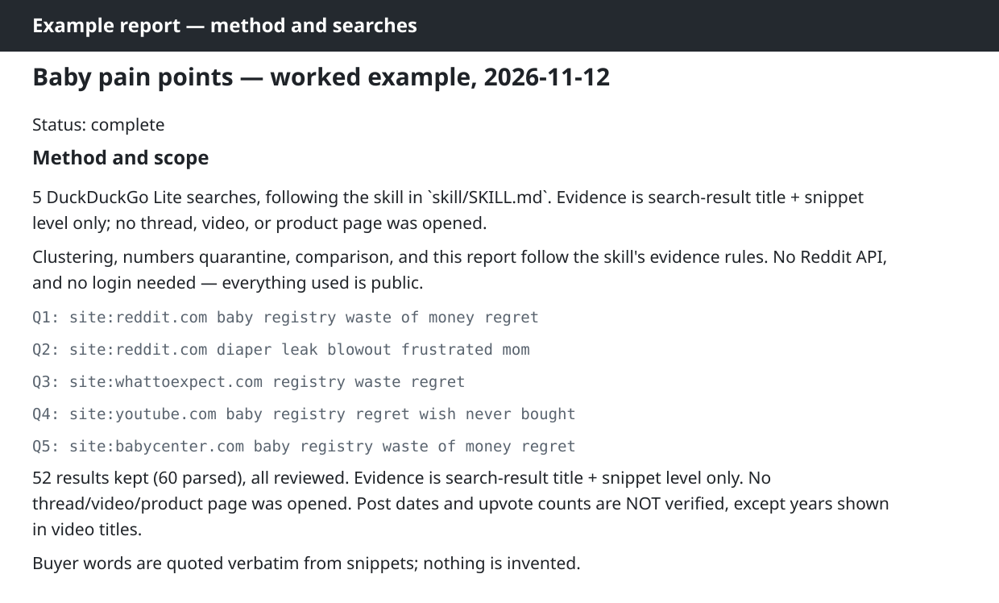
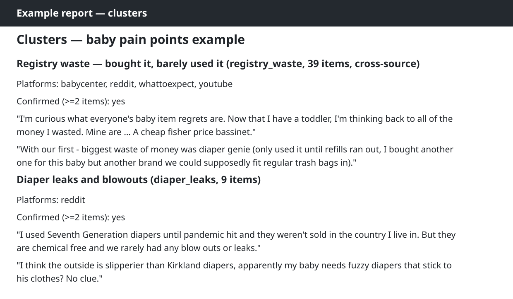

# Reddit Pain Point Research

Find recurring user pain points from public discussions — Reddit
first, plus other communities where the topic lives — with cited
evidence and an approved outline, without using the Reddit API.

This repo contains one thing: a skill (`skill/`). A skill is a
workflow any assistant that can search the web and open pages can
follow. It works on its own.

The baby-products run in `examples/` is the one worked example. The
skill itself is not baby-specific.

## What this is not

- **Not an MCP server.** There is no MCP wrapper in this repo and no
  MCP server to install. The skill is a markdown workflow. Do not
  describe this repo as an MCP server.
- **Not a Reddit integration.** No Reddit API, and no login needed.
  Everything it uses is public — no account is needed to get the
  information. Searches are public web searches.
- **Not a content generator.** The skill requires an outline approved
  by a human before any full report or article is written. Following
  it produces a fact list, clusters, and a draft outline — not a
  finished article.

## Install

Copy the `skill/` folder into your assistant's skills directory. In
Muse, that directory is `~/workspace/custom-skills/`, so the skill
lands at `~/workspace/custom-skills/reddit_pain_point_research/`
with `SKILL.md` and `skill.yaml` inside it. Other assistants keep
skills elsewhere; follow your assistant's own skill layout and keep
both files together under the `reddit_pain_point_research` folder
name.

There is nothing else to install and nothing to run.

## How the skill works

1. **Frame the question.** Target user, topic, time window,
   geography, and language — one short ask, starting with what the
   user gave when the scope is clear.
2. **Gather evidence without the Reddit API.** Public web search and
   page reading only. Complaint and intent language as well as topic
   terms. Open threads and read comments instead of relying on
   titles alone. Record exact buyer words, upvote count, date, and
   thread URL for each useful post. When only search snippets are
   available, say so plainly: snippet-level evidence, dates and
   upvotes unverified.
3. **Build the fact list and pain clusters.** A fact list comes
   before any report or article, with a source URL per fact. Only
   listed facts may appear in later writing. Several independent
   threads are required before calling a problem recurring. Group
   pains by theme, rank by frequency and intensity, keep each
   cluster separate from any proposed solution, and record counter
   evidence and dissent.
4. **Get outline approval before writing.** Show the clusters, the
   evidence behind each one, and the proposed angles. Wait for the
   user to approve or edit. Say plainly when the evidence is too
   thin, and list the next searches instead of filling the gap.
5. **Present pain points for content.** Clusters in rank order with
   buyer words, evidence links, and honest scope wording. Content
   angles only after outline approval, each tied to its evidence
   links.

See `skill/SKILL.md` for the full workflow.

## Evidence rules (enforced by the skill)

- Fact list first, with a source URL per fact. Only listed facts may
  appear in later writing.
- Numbers quarantine: only numbers found in the results, each tied to
  its source URL, may be reused. No invented counts, percentages, or
  prices.
- Per-platform tagging plus a `cross_source` flag when a cluster
  spans platforms. Cross-community agreement counts for more than
  volume in one place.
- Dated output every run, compared with the previous run where one
  exists (new vs. seen URLs).
- Follow-up searches are recorded and never run automatically.
- Outline approval is required before any full write-up. Thin
  evidence is reported as thin, with next searches listed, never
  padded with guesses.
- Health and safety content uses general-information-only wording and
  is never presented as medical advice. Safety claims need
  authoritative grounding for the topic.

## Worked example: baby products

`examples/baby-products/` holds the one worked example, from
2026-11-12: 5 DuckDuckGo Lite searches, 52 facts kept, 4 numbers
quarantined. Top clusters: registry waste (39 items, cross-source
across Reddit, YouTube, BabyCenter, and What to Expect) and diaper
leaks/blowouts (9 items, Reddit only). The draft outline was never
turned into a full write-up in that run: per the skill, an outline
needs user approval before any article is written.

Read the caveats in `examples/baby-products/README.md` before reusing
any of it. In short: evidence is snippet-level only, dates and
upvote counts are unverified, clusters are keyword-grouped rather
than semantic, 2 of the 52 facts are search-page noise kept
honestly, and no retailer buyer-review evidence is included. Do not
quote cluster sizes as prevalence — they count search results kept,
not users.

Rendered previews of the example report (excerpts, verbatim text
from the report files; the full report is in `examples/`):





## Writing a new topic

`topics/baby-products.json` is an example topic plan: the queries
and cluster keywords used for the worked example. Copy it, change
the `slug`, `queries`, and `clusters`, and read `topics/README.md`
for the field reference and rules. Keep queries short and `site:`-
scoped, keep cluster keywords specific, and do not present a new
topic as tested until it has been worked through with its own
evidence.

## Repository layout

```
README.md                  This file.
LICENSE                    MIT License.
skill/
  SKILL.md                 The workflow (general).
  skill.yaml               Skill metadata.
topics/
  README.md                How to write a topic plan.
  baby-products.json       The one example topic plan.
examples/
  baby-products/           Worked example output of the 2026-11-12
                           run, with honest caveats in its README,
                           plus two rendered report previews.
```

## About

This repo packages a research workflow built with help from Muse,
using the Reddit pain-point research skill first proven on a
baby-products topic on 2026-11-12.

If you're new to Muse, you can redeem invite code `VSJG25` in the
Muse app under Settings > Redeem token within your first 48 hours
after joining (on the web: Settings > General > Usage > Redeem
invite code).

The example topic is used on Instagram at
[@babybestseller](https://www.instagram.com/babybestseller/) and on
[Shop Online Deals](https://shoponlinedeals.wixsite.com/2023). Those
pages are not part of this repo; the research evidence for the
example run is in `examples/`, not in screenshots.

## License

This repo is licensed under the MIT License. See
[LICENSE](LICENSE).
